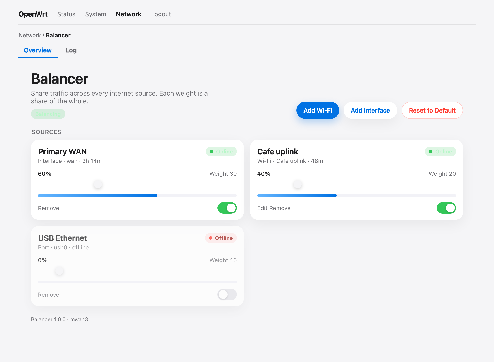
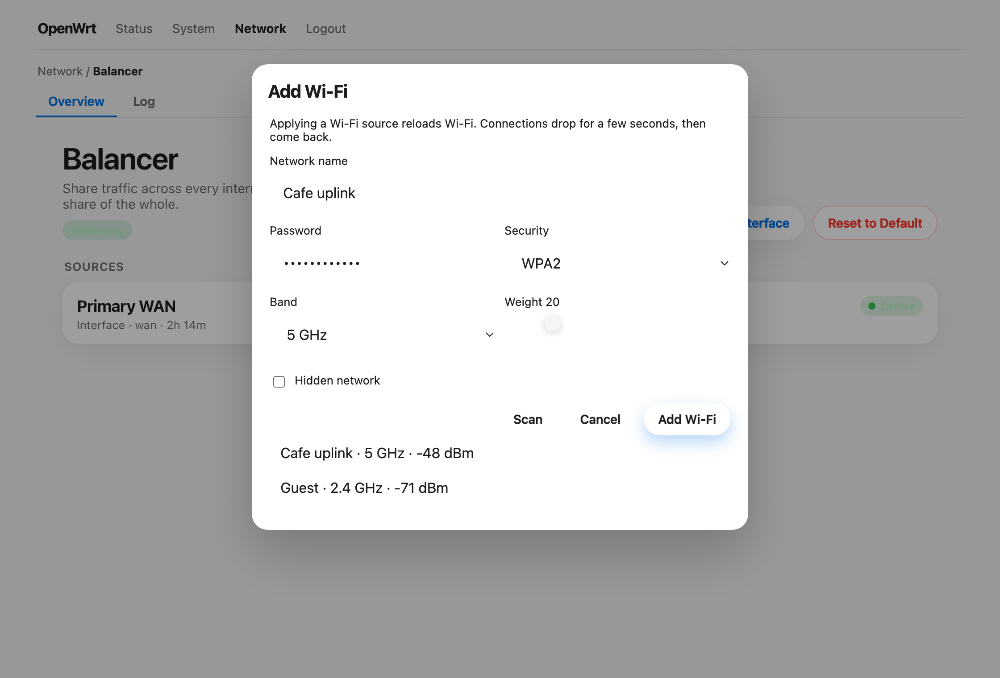
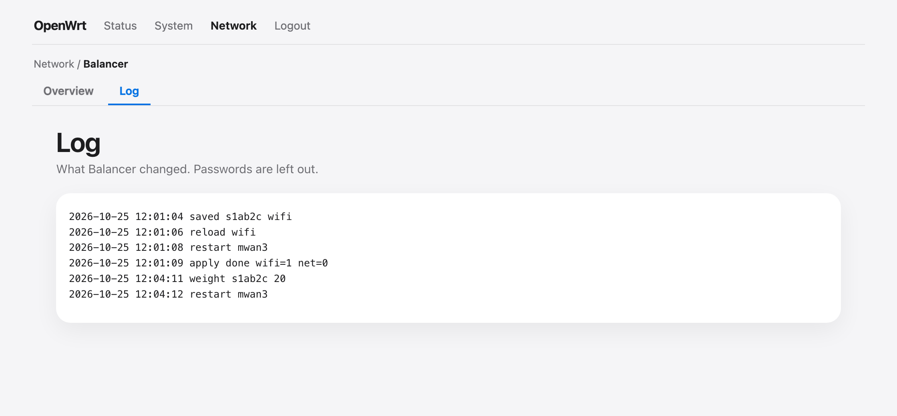

<h1>openwrt-balancer</h1>

<a href="README.md">English</a> · فارسی

یک برنامه LuCI به نام <code>luci-app-balancer</code> که تقسیم بار چند WAN را ساده و قابل دیدن می‌کند. این برنامه روی <a href="https://openwrt.org/docs/guide-user/network/wan/multiwan/mwan3">mwan3</a> می‌نشیند. شبکه وای‌فای یا درگاه فیزیکی اضافه می‌کنید، به هر کدام یک وزن می‌دهید، و روتر اتصال‌های تازه را بین آن‌ها تقسیم می‌کند.

صفحه چند کارت است: منبع، وضعیت آنلاین یا آفلاین، و یک لغزنده وزن. <strong>بازگشت به حالت پیش‌فرض</strong> سیاست تک‌WAN اصلی را برمی‌گرداند.

<h2>نصب سریع روی OpenWrt 25.12 LTS</h2>

فایل منتشرشده روی گیت‌هاب بسته OpenWrt <strong>25.12</strong> است (apk و firewall4). معماری بسته <code>noarch</code> است، پس همین apk روی همه هدف‌های 25.12 نصب می‌شود.

اگر <code>mwan3</code> نصب نیست، اول آن را اضافه کنید:

<pre dir="ltr"><code>apk add mwan3</code></pre>

روی خود روتر، نسخه 1.0.0 را بگیرید و نصب کنید:

<pre dir="ltr"><code>wget -O /tmp/luci-app-balancer.apk \
  https://github.com/WhoisGray/openwrt-balancer/releases/download/v1.0.0/luci-app-balancer-1.0.0-r1.apk
apk add --allow-untrusted /tmp/luci-app-balancer.apk</code></pre>

بعد <strong>Network → Balancer</strong> را باز کنید:

<code>http://&lt;router&gt;/cgi-bin/luci/admin/network/balancer</code>

اگر گزینه منو دیده نشد، از LuCI خارج شوید و دوباره وارد شوید.

نسخه‌های بعدی در <a href="https://github.com/WhoisGray/openwrt-balancer/releases">صفحه انتشارها</a> هستند. فایل <code>.apk</code> را بردارید. برای نصب انتشاری که به‌عنوان آخرین نسخه علامت خورده:

<pre dir="ltr"><code>wget -q -O /tmp/balancer-release.json \
  https://api.github.com/repos/WhoisGray/openwrt-balancer/releases/latest
url=$(jsonfilter -i /tmp/balancer-release.json -e '@.assets[0].browser_download_url')
wget -O /tmp/luci-app-balancer.apk "$url"
apk add --allow-untrusted /tmp/luci-app-balancer.apk</code></pre>

حذف بسته، سیاست اصلی را برمی‌گرداند:

<pre dir="ltr"><code>apk del luci-app-balancer</code></pre>

نصب، تعادل را اعمال نمی‌کند و وای‌فای را دوباره بارگذاری نمی‌کند. تا وقتی منبعی اضافه و اعمال نکنید چیزی عوض نمی‌شود.

<h2>چه کارهایی می‌شود کرد</h2>

<ul>
<li>چند شبکه وای‌فای را به‌عنوان WAN (حالت station) با وزن جدا اضافه کنید</li>
<li>از یک رابط موجود (WAN، اترنت USB و مانند آن) یا یک درگاه آزاد استفاده کنید</li>
<li>هر منبع، سهمش از ترافیک، و آنلاین بودن آن را ببینید</li>
<li>لغزنده وزن را تکان دهید تا mwan3 بدون بارگذاری دوباره وای‌فای به‌روز شود</li>
<li>گزارش کوتاهی از تغییرها بخوانید</li>
<li>سیاست <code>balanced</code> اصلی mwan3 را با یک تأیید برگردانید</li>
</ul>

<h2>نیازها</h2>

<ul>
<li>OpenWrt 25.12 یا جدیدتر (apk و firewall4)</li>
<li>بسته <code>mwan3</code> و رابط پایه LuCI</li>
<li><code>luci-app-mwan3</code> برای صفحه‌های پیشرفته مفید است و وابستگی این بسته نیست</li>
</ul>

<h2>تعادل چطور کار می‌کند</h2>

mwan3 از قبل سیاستی به نام <code>balanced</code> دارد. در نصب معمولی، قانون HTTPS و قانون‌های پیش‌فرض از همین سیاست استفاده می‌کنند، پس عوض کردن فهرست عضوهای آن، شکل تقسیم ترافیک را عوض می‌کند.

تا وقتی Balancer اعمال شده، فقط همان فهرست عضو را در اختیار دارد:

<ul>
<li>هر منبع روشن، یک عضو mwan3 می‌شود</li>
<li>عضو‌ها <strong>متریک یکسان</strong> و <strong>وزن متفاوت</strong> دارند؛ این یعنی تقسیم بار</li>
<li>متریک متفاوت یعنی جایگزینی هنگام قطعی، و این برنامه آن کار را نمی‌کند</li>
<li>لغزنده وزن همان سهم است. دو منبع با وزن ۱۰ و ۱۰ هر کدام نصف می‌گیرند. منبع ۳۰ کنار منبع ۱۰ حدود سه‌چهارم را می‌گیرد</li>
</ul>

اولین اعمال، فهرست قبلی عضوهای <code>balanced</code> را داخل <code>/etc/config/balancer</code> ذخیره می‌کند. بازگشت به پیش‌فرض همان فهرست را برمی‌گرداند. بخش‌های اصلی مثل <code>wan</code> و <code>lan</code> و <code>wan_m1_w3</code> سر جایشان می‌مانند. چیزی که این برنامه می‌سازد با <code>option balancer '1'</code> علامت می‌خورد و فقط همان‌ها پاک می‌شوند.

رمز وای‌فای در <code>/etc/config/balancer</code> (حالت <code>600</code>) می‌ماند و هنگام اعمال به تنظیم بی‌سیم کپی می‌شود. در گزارش و صفحه وضعیت نوشته نمی‌شود.

<h2>ایمنی</h2>

<ul>
<li>افزودن منبع وای‌فای دستور <code>wifi reload</code> را اجرا می‌کند. کلاینت‌های بی‌سیم چند ثانیه قطع می‌شوند.</li>
<li>افزودن درگاه می‌تواند شبکه را دوباره بارگذاری کند. نشانی WAN دوباره از DHCP می‌آید.</li>
<li>درگاهی که عضو پل LAN است فقط بعد از تأیید شما از پل جدا می‌شود. بازگشت به پیش‌فرض آن را برمی‌گرداند.</li>
<li>خود پل LAN یعنی <code>br-lan</code> نمی‌تواند WAN شود.</li>
<li>اگر همه منبع‌ها خاموش باشند اعمال رد می‌شود تا سیاست تصادفاً خالی نماند.</li>
<li>حذف بسته همان بازگردانی <strong>Reset to Default</strong> را اجرا می‌کند.</li>
</ul>

اگر این روتر تنها راه شما به شبکه است، قبل از تکیه بر uplink تازه وای‌فای، WAN سالم را هم به‌عنوان منبع اضافه کنید.

<h2>کار با برنامه</h2>

<ol>
<li>بسته را نصب کنید و <strong>Network → Balancer</strong> را باز کنید.</li>
<li>برای هات‌اسپات یا ISP دوم <strong>Add Wi-Fi</strong> را بزنید، یا برای درگاهی که از قبل اینترنت دارد <strong>Add interface</strong> را.</li>
<li>وزن بگذارید. کارت، وزن و درصد آن از جمع را نشان می‌دهد.</li>
<li>نشان <strong>Online</strong> وقتی روشن می‌شود که پیوند نشانی IPv4 داشته باشد یا ردیابی mwan3 آن را بالا بداند.</li>
<li>لغزنده را بکشید. درصد همان لحظه عوض می‌شود و با رها کردن، mwan3 یک‌بار راه‌اندازی می‌شود. وای‌فای دوباره بارگذاری نمی‌شود.</li>
<li><strong>Reset to Default</strong> سیاست اصلی را برمی‌گرداند. اگر می‌خواهید بعداً همان فهرست را دوباره اعمال کنید، گزینه فراموش کردن منبع‌های ذخیره‌شده را تیک نزنید.</li>
</ol>

صفحه <strong>Log</strong> آخرین خط‌های <code>/var/log/balancer.log</code> را نشان می‌دهد. رمزها در آن نیستند.

<h3>خط فرمان</h3>

<code>balancerctl</code> یک شیء JSON چاپ می‌کند. صفحه وب همین را صدا می‌زند.

<pre dir="ltr"><code>balancerctl status
balancerctl log
balancerctl scan 5g
balancerctl apply
balancerctl reset
balancerctl reset 1          # بازگردانی WAN و پاک کردن منبع‌های ذخیره‌شده
balancerctl set_weight s1ab2c 40
balancerctl enable s1ab2c 0</code></pre>

دستور <code>save</code> یک فایل JSON می‌خواند (رابط وب آن را می‌سازد). معمولاً منبع را از صفحه وب اضافه می‌کنید.

<h2>کپی فایل‌ها بدون apk</h2>

از یک رونوشت این مخزن، روی رایانه‌ای که به روتر دسترسی دارد:

<pre dir="ltr"><code>ROUTER=root@192.168.1.1 sh scripts/install-live.sh</code></pre>

اسکریپت از <code>scp -O</code> استفاده می‌کند چون Dropbear در OpenWrt سرور SFTP ندارد. <code>rpcd</code> و کش منوی LuCI را تازه می‌کند. سیاست را اعمال نمی‌کند و وای‌فای را دوباره بارگذاری نمی‌کند.

<h2>ساخت apk با SDK اوپن‌ورت</h2>

بسته‌های OpenWrt 25.12 فایل apk هستند و سیستم ساخت معمولی تصویر آن‌ها را می‌سازد.

<ol>
<li>SDK یا درخت ساخت هم‌خوان با هدف خود را بگیرید؛ مثلاً <code>ipq40xx/chromium</code> برای Google WiFi (Gale).</li>
<li>این مخزن را داخل درخت کپی کنید:</li>
</ol>

<pre dir="ltr"><code>cp -a openwrt-balancer /path/to/openwrt/package/luci-app-balancer</code></pre>

<ol start="3">
<li>ترجمه کنید:</li>
</ol>

<pre dir="ltr"><code>cd /path/to/openwrt
make package/luci-app-balancer/compile V=s</code></pre>

<ol start="4">
<li>بسته زیر <code>bin/packages/&lt;arch&gt;/base/</code> قرار می‌گیرد و نامی مثل <code>luci-app-balancer-1.0.0-r1.apk</code> دارد. <code>PKGARCH</code> برابر <code>all</code> است، پس همان apk روی هر معماری نصب می‌شود.</li>
<li>آن را به روتر ببرید و نصب کنید:</li>
</ol>

<pre dir="ltr"><code>scp -O bin/packages/*/base/luci-app-balancer-*.apk root@192.168.1.1:/tmp/
ssh root@192.168.1.1 'apk add --allow-untrusted /tmp/luci-app-balancer-*.apk'</code></pre>

<h2>فایل‌ها</h2>

<table>
<thead>
<tr><th>مسیر</th><th>نقش</th></tr>
</thead>
<tbody>
<tr><td><code>Makefile</code></td><td>بسته OpenWrt</td></tr>
<tr><td><code>root/usr/sbin/balancerctl</code></td><td>تغییر UCI و mwan3 و شبکه و وای‌فای</td></tr>
<tr><td><code>root/usr/share/rpcd/ucode/luci.balancer</code></td><td>متدهای ubus برای LuCI</td></tr>
<tr><td><code>root/usr/share/rpcd/acl.d/luci-app-balancer.json</code></td><td>ACL</td></tr>
<tr><td><code>root/usr/share/luci/menu.d/luci-app-balancer.json</code></td><td>منوی Network → Balancer</td></tr>
<tr><td><code>htdocs/.../overview.js</code></td><td>داشبورد</td></tr>
<tr><td><code>htdocs/.../log.js</code></td><td>صفحه گزارش</td></tr>
<tr><td><code>htdocs/.../balancer.css</code></td><td>چیدمان و حرکت</td></tr>
<tr><td><code>root/etc/config/balancer</code></td><td>پیکربندی پیش‌فرض</td></tr>
<tr><td><code>docs/images/</code></td><td>تصویرهای همین راهنما</td></tr>
<tr><td><code>README.md</code></td><td>همین صفحه به انگلیسی</td></tr>
</tbody>
</table>

<h2>مجوز</h2>

مجوز Apache 2.0. متن کامل در <a href="LICENSE">LICENSE</a> است.

